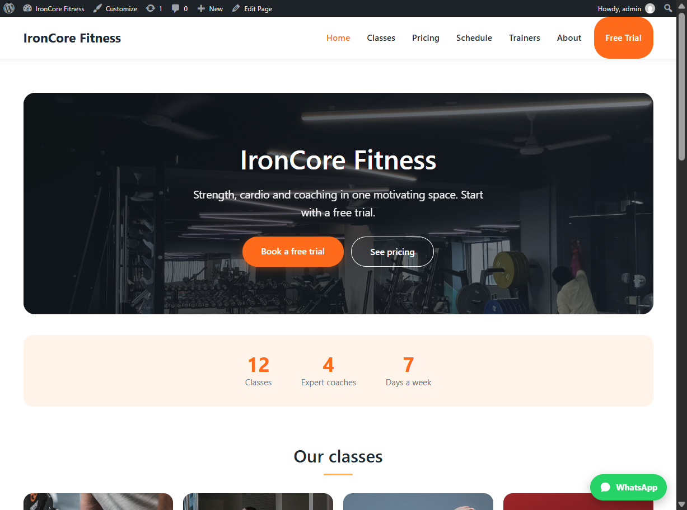
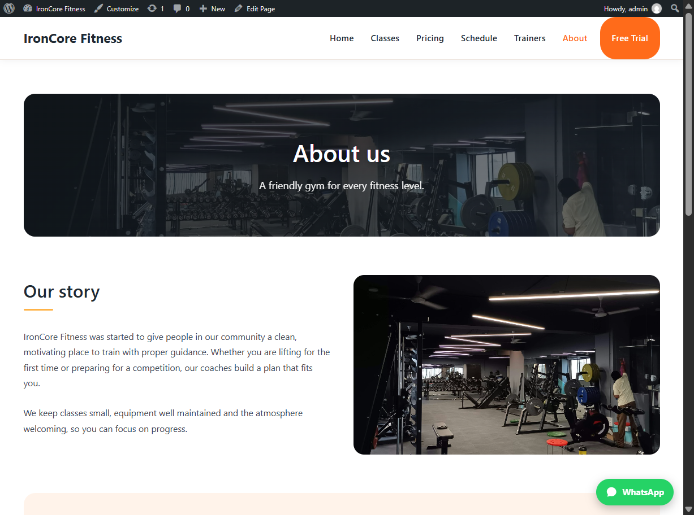
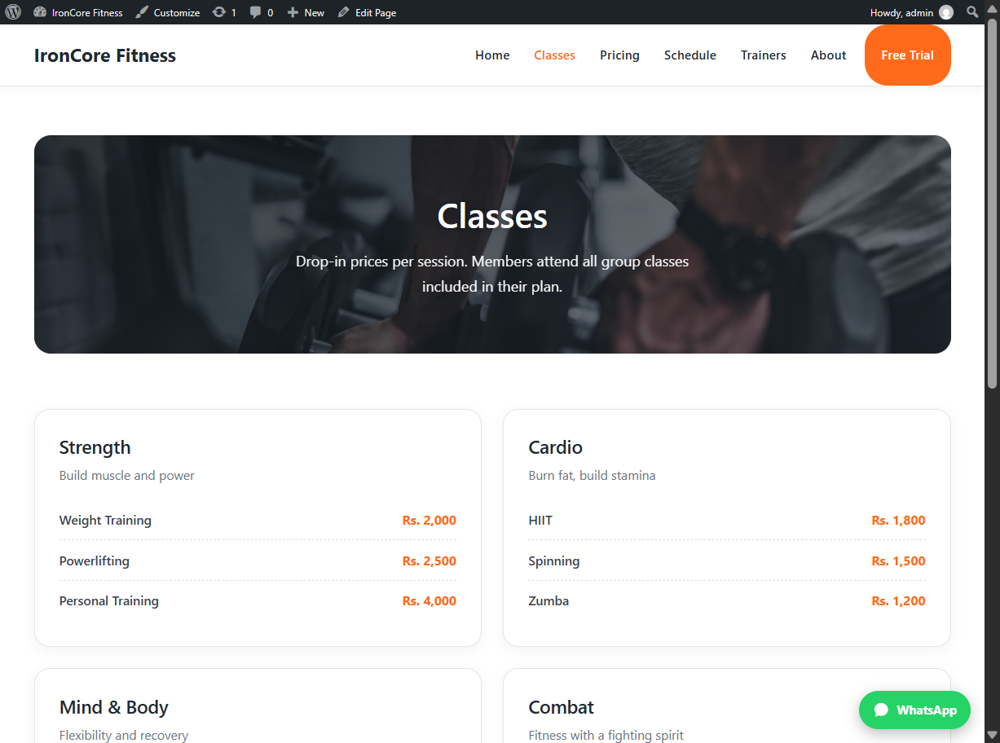
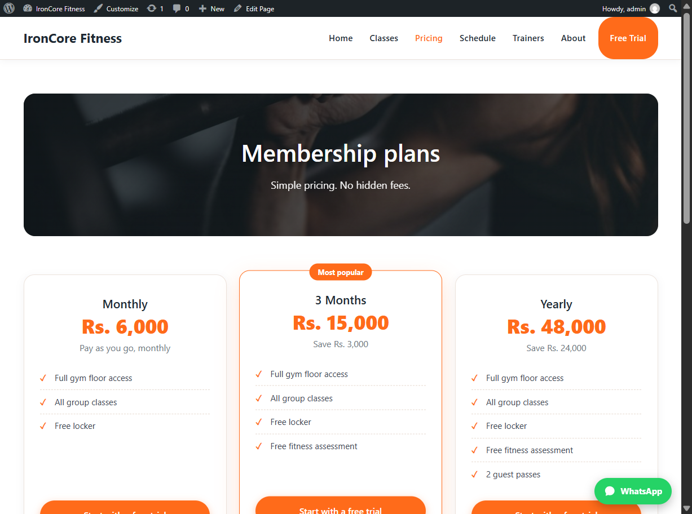
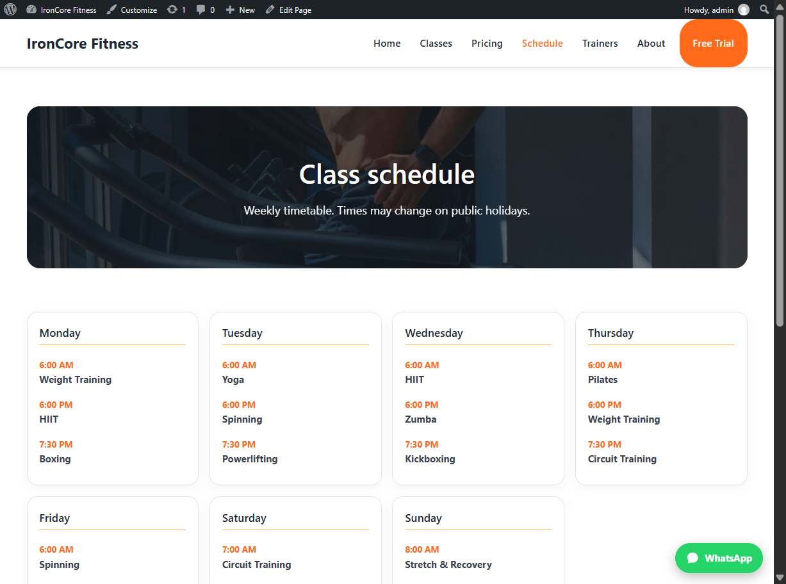
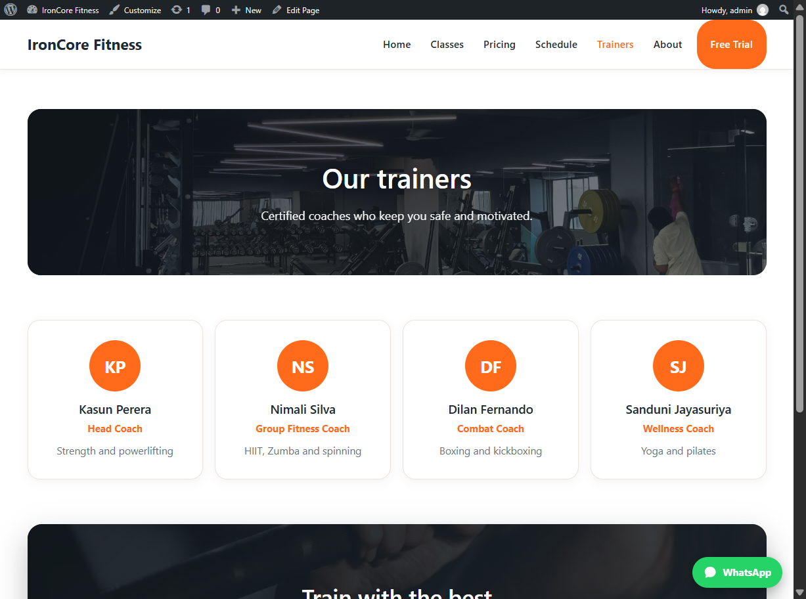
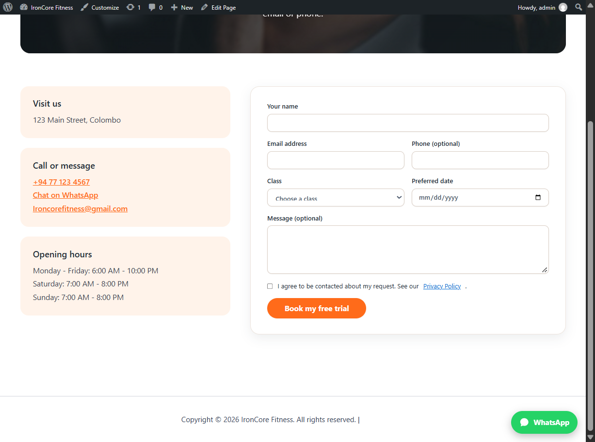

# IronCore Fitness – Gym Website

A professional, responsive gym website built with **WordPress**, the free **Astra** theme, and a custom PHP plugin. The project includes pages for gym information, classes, membership pricing, weekly schedules, trainers, and free-trial bookings.

> **Portfolio/demo note:** The classes, prices, coaches, timetable, FAQ, and About page content are sample content. Replace them with accurate business information before using the website for a real gym.

## Website Screenshots

### Home Page


### About Page


### Classes Page


### Membership Pricing


### Weekly Class Schedule


### Trainers Page


### Contact & Free-Trial Booking


## Features

### Website Pages
- Automatically creates eight pages: Home, About, Classes, Pricing, Schedule, Trainers, Contact, and Privacy Policy.
- Responsive layouts for desktop, tablet, and mobile.
- Charcoal and orange visual styling.
- Trainer cards, FAQ section, membership plans, and weekly class timetable.

### Classes & Memberships
- Classes grouped into Strength, Cardio, Mind & Body, and Combat categories.
- Sample class options include weight training, powerlifting, HIIT, spinning, Zumba, yoga, Pilates, boxing, and kickboxing.
- Monthly, 3-month, and yearly membership plans.
- Automatic savings calculation for multi-month plans.

### Free-Trial Booking System
- Booking form for a visitor's name, email, optional phone number, selected class, preferred date, and optional message.
- Required consent checkbox and server-side validation.
- WordPress nonce verification, hidden honeypot field, input sanitisation, and a rate limit of five requests per hour per visitor.
- **Trial Bookings** inbox in the WordPress admin.
- Booking statuses: New, Confirmed, Completed, and Cancelled.
- Email notification to the gym owner and confirmation email to the member.

### Business Settings & Contact
- **Settings → IronCore Fitness** page for business name, description, phone, WhatsApp, email, address, Google Maps embed, opening hours, social links, and member reviews.
- Floating WhatsApp button and click-to-call phone link.
- Google Map is displayed when a map embed is configured.
- Member reviews section remains hidden when no reviews are entered.

### SEO & Accessibility
- Meta description and Open Graph metadata.
- `HealthClub` structured data (JSON-LD).
- Built-in SEO output is skipped when Yoast SEO, Rank Math, or AIOSEO is active.
- Visible focus outlines, labelled form fields, ARIA message roles, and reduced-motion support.

## Technologies Used

- **CMS:** WordPress
- **Theme:** Astra (free)
- **Backend:** PHP (custom WordPress plugin)
- **Styling:** CSS
- **Local development:** WAMP
- **Version control:** Git and GitHub

## Custom WordPress Plugin

The project-specific functionality is contained in:

`plugin/ironcore-fitness-setup/`

The plugin handles:
- Automatic page and navigation setup.
- Classes, membership plans, schedules, trainers, and FAQ content.
- Custom shortcodes for displaying website sections.
- Business settings and contact information.
- Free-trial booking form and admin booking inbox.
- Booking status management and email notifications.
- SEO metadata, structured data, and WhatsApp contact button.

### Available Shortcodes

```text
[ic_booking]
[ic_trainers]
[ic_pricing]
[ic_schedule]
[ic_faq]
[ic_hours]
[ic_contact_info]
[ic_map]
[ic_social]
[ic_testimonials]
[ic_name]
```

## Project Structure

```text
ironcore-fitness-main/
├── docs/
│   └── screenshots/
│       ├── home.png
│       ├── about.png
│       ├── classes.png
│       ├── pricing.png
│       ├── schedule.png
│       ├── trainers.png
│       └── contact.png
│
├── plugin/
│   └── ironcore-fitness-setup/
│       ├── css/
│       │   └── ironcore-fitness.css
│       ├── images/
│       │   ├── hero.jpg
│       │   ├── strength.jpg
│       │   ├── cardio.jpg
│       │   ├── mind.jpg
│       │   └── cta.jpg
│       └── ironcore-fitness-setup.php
│
├── .gitattributes
├── .gitignore
└── README.md
```

## Local Installation (WAMP)

### Requirements
- WAMP Server.
- A local WordPress installation.
- The free Astra theme.

### Setup Steps
1. Start WAMP Server.
2. Create a MySQL database for the local WordPress website.
3. Install WordPress in your local web directory (for example, `C:\\wamp64\\www\\gym`).
4. Open the WordPress dashboard and install and activate the **Astra** theme.
5. Create a ZIP file of the `plugin/ironcore-fitness-setup/` folder.
6. In WordPress, go to **Plugins → Add New → Upload Plugin**, upload the ZIP file, and activate **IronCore Fitness Setup**.
7. Go to **Settings → Permalinks**, select **Post name**, and save the changes.
8. Open **Settings → IronCore Fitness** and enter the real business details.
9. Review the generated pages and replace the sample content before launch.

> This repository contains the custom plugin, its styling and images, documentation, and screenshots. It does not include WordPress core, a database export, or a complete local website installation.

## Before Going Live

- Replace the sample class names, prices, membership plans, weekly timetable, trainer profiles, and FAQ content in the corresponding functions near the top of `ironcore-fitness-setup.php`: `ic_classes`, `ic_plans`, `ic_schedule`, `ic_trainer_list`, and `ic_faqs`.
- Review and update the About page and Privacy Policy text for the actual business. The privacy content is a basic template and should be reviewed before commercial use.
- Add the real business details under **Settings → IronCore Fitness**, including the Google Maps embed.
- Enter genuine member reviews only. The testimonials section stays hidden while empty.
- Configure SMTP (for example, with an SMTP plugin) to improve booking email delivery reliability.
- Use HTTPS, keep WordPress and the Astra theme updated, and maintain regular backups.
- A `combat.jpg` image is optional; the project README notes that it can be added to the plugin images folder.

## Repository & Security Notes

- `wp-config.php`, SQL database dumps, logs, environment files, WordPress uploads, and cache files are excluded through `.gitignore`.
- Do not commit passwords, database credentials, API keys, private member details, or production configuration files.
- Configure the local WordPress database and business contact details in your own environment.

## Credits

Website photography is sourced from [Unsplash](https://unsplash.com) under the Unsplash License. Credits listed in the original project documentation:
- Dumbbells (strength): Anastase Maragos
- Treadmill (cardio): Sour Moha
- Barbell (call-to-action): Tyler Raye
- Gym interior (hero): Jinish Shah
- Yoga (mind & body): Alex Shaw
